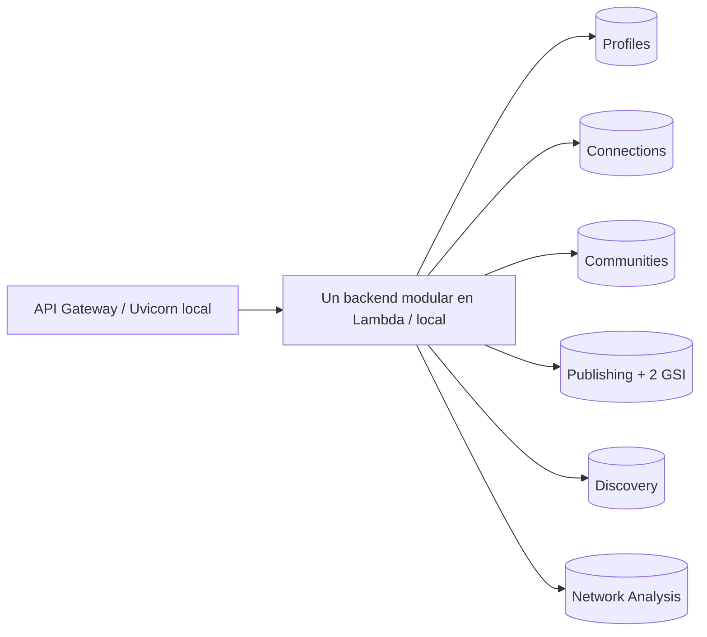

# Decisión de persistencia de Outspark

Decisión de ingeniería: múltiples tablas entre contextos y colecciones de ítems relacionadas dentro de cada tabla. El backend sigue siendo un monolito modular FastAPI/Mangum desplegable como una Lambda. Esta decisión se basa en las consultas implementadas, no en una regla de que DDD exija una tabla por contexto.



## Tablas y patrones de acceso

| Contexto | Tabla local | Colecciones que permanecen juntas |
| --- | --- | --- |
| Profiles | `Outspark-local-profiles` | Perfil, preferencias y marcador de semilla |
| Connections | `Outspark-local-connections` | Amistad canónica y los dos contactos consultables |
| Communities | `Outspark-local-communities` | Comunidad, catálogos, reserva de nombre y membresías en ambas direcciones |
| Publishing | `Outspark-local-publishing` | Original, eventos, participación única, comentarios e idempotencia |
| Discovery | `Outspark-local-discovery` | Snapshot cerrado y puntero de historial por destinatario |
| Network Analysis | `Outspark-local-network-analysis` | Manifiesto, nodos, vecinos, filas originales, muro y bloques binarios del dataset |

Todas usan PK/SK y `PAY_PER_REQUEST`. **Solo Publishing tiene ActivityByActor y PublicationsByCommunity**, con las mismas proyecciones pequeñas. Los otros contextos consultan por claves y no necesitan GSI actualmente. [Contratos completos CreateTable](../dynamodb/tablas_dynamodb.json); esquema de [Publishing](../dynamodb/tabla_dynamodb.json) y [tabla base](../dynamodb/base_table.json). No son una plantilla SAM ni acreditan un despliegue AWS.

La tabla inicial compartida simplificó la primera configuración. Sin embargo, el feed consulta perfiles, contactos, membresías y publicaciones mediante proveedores independientes; no aprovecha una única Query que reúna esos contextos. Mantenerlos en una tabla no elimina esas lecturas. El histórico inmutable y los snapshots tienen ciclos de vida distintos a publicaciones y cuentas. Separar las tablas permite configurar retención, respaldos y permisos de cada conjunto al preparar cloud.

La contrapartida es gestionar seis recursos y sus alarmas. Las lecturas entre contextos continúan siendo múltiples; no se promete una reducción de latencia por separarlos. Con pago por uso, el número de tablas no multiplica automáticamente por seis la factura: se deben medir solicitudes, almacenamiento, índices y funcionalidades habilitadas. En la Lambda compartida, el rol tendrá acceso a las tablas necesarias; la separación por tablas por sí sola no proporciona aislamiento IAM por módulo.

## Composición, contratos y transacciones

`outspark/persistence.py` configura un cliente y seis adaptadores técnicos. `bootstrap.py` entrega a cada repositorio de contexto exclusivamente su tabla. Los servicios siguen usando los puertos del consumidor y las fachadas públicas del proveedor; el dominio no conoce nombres de tablas ni DynamoDB.

Una transacción puede comprobar perfiles y membresías, y escribir un original en Publishing. Las garantías semánticas se traducen en ConditionCheck por sus propietarios y se incluyen junto con las escrituras en un único TransactWriteItems. La unidad de trabajo identifica cada registro por **TableName + PK + SK**; claves iguales en dos tablas son registros distintos. No se sustituyen condiciones atómicas por una validación previa.

Lambda requiere `OUTSPARK_TABLE_PREFIX`, por ejemplo `Outspark-dev`. Los nombres resultan `Outspark-dev-profiles`, `-connections`, `-communities`, `-publishing`, `-discovery` y `-network-analysis`. No crea tablas al arrancar. IaC, IAM, Cognito y la decisión de qué volumen histórico subir a AWS siguen pendientes. En local, `--table-prefix` admite únicamente Outspark-local o prefijos desechables de pruebas; las credenciales son ficticias y explícitas.

## Migración local y recuperación

La migración es una operación administrativa separada del inicio de API y de la importación del dataset. Detén todas las escrituras de la tabla inicial, incluidas las consultas de edición del IDE:

```bash
.venv/bin/python -m scripts.migrate_context_tables --source-quiesced
.venv/bin/python -m outspark.local --prepare
```

El comando guarda una copia completa de atributos SDK, incluidos los binarios, en `.local/migration-context-tables/source.jsonl.gz`, un índice de claves/hashes y un inventario por propietario. **La tabla Outspark-local se conserva y no se modifica.** La clasificación utiliza PK y SK; USER# aparece en varios contextos y no basta para asignar un propietario. Una clave desconocida aborta antes de copiar.

Los destinos deben estar vacíos. La copia preserva IDs, fechas, preferencias, estados, registros idempotentes y snapshots. Lee con Scan administrativo paginado de hasta 500 ítems, escribe lotes de hasta 25 con cuatro trabajadores y una cola acotada, verifica cantidades y suma de hashes SHA-256 de los atributos completos por contexto, y vuelve a comprobar que el origen no cambió. La API solo cambia de almacenamiento después de PASS. La paginación respeta también el límite de 1 MiB de Scan; ConsistentRead no equivale a aislamiento de snapshot, por lo que deben estar detenidas las escrituras del origen y destino. [AWS: Scan](https://docs.aws.amazon.com/amazondynamodb/latest/APIReference/API_Scan.html). GetItem/Query/BatchGet permanecen como lecturas de los endpoints; la migración no incorpora Scan al feed.

Si se interrumpe después de completar la copia de seguridad, conserva la carpeta y repite con `--resume --source-quiesced`. Solo acepta registros de destino idénticos a los esperados. Si hay datos ajenos o modificados, aborta sin sobrescribirlos. Si la copia inicial quedó incompleta antes de generar source.json, conserva esa carpeta y usa otra mediante `--backup`. No borres datos para resolver un conflicto.

La preparación local rechaza sembrar el nuevo esquema si encuentra la tabla inicial sin un recibo PASS en la carpeta predeterminada. El respaldo y los datos quedan fuera de Git. El rollback requiere la versión anterior del backend, disponible en su historial Git, y la tabla original conservada; las escrituras posteriores al cambio pertenecen a las tablas nuevas y deben reconciliarse antes de volver atrás. No se presenta el rollback como una conmutación sin pérdida de escrituras posteriores.

PyCharm conserva la misma conexión local: refresca su árbol y usa [consultas filtradas](consultas_dynamodb_local.sql). Separar tablas no hace conveniente un SELECT * sin filtro sobre todo el histórico.

## Evidencia y fuentes

Las pruebas reales de DynamoDB Local verifican el flujo entre contextos, la cancelación de una publicación si cambia la membresía, dos condiciones con la misma PK/SK en tablas distintas, copia íntegra de atributos binarios, reanudación y rechazo de sobrescrituras o respaldos dañados. La prueba del dataset completo tiene su recibo independiente; no se infiere de una fixture pequeña.

Migración local completada con **334 275 ítems**, inventarios idénticos por contexto y origen sin modificaciones: [recibo de integridad](../evidencia/migracion_contextos.json). Se reconstruyeron los dos archivos originales desde Network Analysis y coincidieron sus bytes y SHA-256; también se consultaron la publicación, el snapshot y la ruta anteriores al cambio: [verificación SDK/HTTP](../evidencia/verificacion_contextos_http.json). El recorrido nuevo publicar → republicar → procedencia y el alcance del grafo completo pasaron contra la API reiniciada: [demo HTTP posterior](../evidencia/demo_contextos_http.json). Las nuevas escrituras de esta demo son posteriores al inventario de migración.

Validación de código: [50 pruebas del backend](../evidencia/pruebas_contextos.txt) y [seis pruebas de migración tras ajustar la copia por lotes](../evidencia/pruebas_migracion.txt), todas aprobadas. PyCharm muestra las seis tablas activas y la original conservada; sus [22 consultas comentadas](consultas_dynamodb_local.sql) devolvieron datos: [resultados PartiQL](../evidencia/consultas_dynamodb_local.json). La consulta del grupo USER#ana mostró PROFILE y PREFS en dos filas del IDE.

Fuentes externas de ingeniería, consultadas el 12/10/2026: [AWS: fundamentos single-table y multiple-table](https://docs.aws.amazon.com/amazondynamodb/latest/developerguide/data-modeling-foundations.html), [AWS: modelar por patrones de acceso y límites operativos](https://docs.aws.amazon.com/amazondynamodb/latest/developerguide/bp-modeling-nosql.html), [AWS: transacciones entre tablas de una misma cuenta y región](https://docs.aws.amazon.com/amazondynamodb/latest/developerguide/transaction-apis.html). Los algoritmos académicos continúan sustentados por el material del curso en ALGORITMOS.md; esta decisión no añade técnicas algorítmicas al temario.
